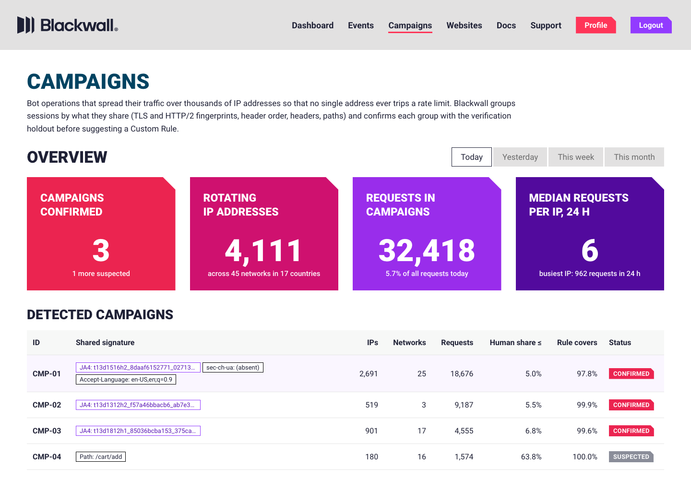

# Campaigns · catch bot operations that rotate thousands of IPs, then turn them into Custom Rules

**Live demo:** https://mohith26.github.io/blackwall-campaigns/ · unofficial concept by Mohith Gajjela, not affiliated with Blackwall.

The bot traffic that hurts hosting customers most in 2026 does not come from one noisy address. Price scrapers and AI crawlers buy residential and mobile proxies, so each IP sends a handful of requests a day and never trips GateKeeper's per-IP limit (24 new connections per second) or a per-IP Custom Rule. What they cannot rotate as cheaply is *how* they talk: the TLS and HTTP/2 stack, header order, client hints, Accept-Language, the paths they want. **Campaigns** is a page in the Blackwall Dashboard, next to Events. It mines the sessions that got through for attribute combinations that span many IPs and almost never pass a challenge, and confirms each one statistically against a randomized verification holdout. It then writes the narrowest Custom Rule, in the editor's own fields (User-Agent, HTTP Header, URI Path, Domain, ASN), that stops the campaign, and reports how many verified humans that rule would touch. Defensive only.



## Results (`data/results.json`, reproduced by the tests)

20 simulated days on one GateKeeper node (40 hosted domains, about 28,000 sessions a day: 20,000 human, 1,800 search-engine, 300 simple datacenter bots, and four campaigns using ~4,200 rotating IPs). Ground truth is used only to score.

| | Share of campaign requests stopped | Share of human sessions hit |
|---|---|---|
| Per-IP rate limit (30 req/min or 1,000/day per IP) | **0.004%** | 0% |
| Block every network the campaigns used (ASN rule) | 100% | **100%** (they share ISPs with real users) |
| **Campaigns: rules for confirmed campaigns** | **94.9%** (min 94.7%) | **0.07%** (max 0.38%) |

- The three large campaigns (residential-proxy price scraper, cloud-hosted AI crawler spoofing Safari, low-and-slow credential stuffing) were **confirmed on 20 of 20 days**, with **0 false confirmations** (no confirmed group was more than 10% human).
- The small cart scalper (180 sessions, 16 networks) was **never confirmed in a single day**. It stays *Suspected*, and the page computes how many targeted challenges would confirm it (56 on the demo day). Its requests are the remaining ~5%.
- Demo day: CMP-01 is 4,021 sessions from 2,691 IPs, and its busiest IP sent 65 requests all day. The suggested rule (User-Agent is any of 6, `sec-ch-ua` is empty, Accept-Language is `en-US,en;q=0.9`, Domain is any of 3) covers 97.8% of it. On the held-out half it matched 1 verified human, a bound of at most 0.43% of human sessions.

## How it works

1. **Verification holdout.** A random 15% of sessions (minus verified search engines) get an invisible challenge. Humans pass about 98.5% of the time and bots almost never do, so for any group of sessions the pass rate among its challenged sessions estimates its human share, with an exact Clopper-Pearson bound.
2. **Mining.** Level-wise enumeration of conjunctions of up to 3 attribute values (JA4, HTTP/2 fingerprint, header order, `sec-ch-ua`, Accept-Language, User-Agent, path, domain, ASN) with support ≥ 60 sessions among traffic that got past the existing rules. About 8,000 combinations a day.
3. **Selective inference by sample splitting.** Sessions are split at random. On the *exploration* half, keep combinations spanning ≥ 20 IPs whose pass rate is under 5%, and choose campaigns by greedy maximum coverage ((1 − 1/e) guarantee). On the *confirmation* half, test only the k chosen campaigns at α/k: a campaign is **confirmed** when its human share is ≤ 10% with 95% family-wise confidence. Testing all 8,000 combinations with Bonferroni would have no power. Testing them on the same data that chose them would be invalid.
4. **Rule synthesis.** Each confirmed campaign gets an exact search over conjunctions of up to 4 conditions in fields the Custom Rules editor supports. The search keeps rules whose 95% upper bound on verified-human matches (exploration half) is ≤ 0.5%. Among those within 3 points of the best coverage, it prefers the fewest human matches. The reported collateral comes from the confirmation half. A toggle also allows *proposed* fields (JA4, HTTP/2, header order) that GateKeeper sees but the editor cannot express yet.
5. **Targeted challenges.** For a suspected campaign the page computes the smallest number of additional challenged sessions (with no passes) that would confirm it, and offers to challenge 100% of matching sessions.

## The app

- **Campaigns** in the top navigation between Events and Websites, in the Dashboard's light theme (Roboto, #E2E1E1 top bar, cut-corner KPI cards in the Statistics colours, Events-style table, Chart.js-style gray chart panel, dark "Top 10 Bot Sources" block, the "ADD A CUSTOM RULE" editor layout).
- Overview: Today / Yesterday / This week / This month (only today has data; other periods show an empty state), four KPIs, the campaign table, and requests per hour per campaign with tooltips.
- Campaign page: the shared fingerprint (share in the campaign vs share among verified humans), holdout evidence, a live rule editor (toggle conditions, switch to proposed fields, choose Deny / CAPTCHA / rate limit; coverage and the human bound recompute in the browser), Add Rule with confirmation, Export rule JSON / sessions CSV, Top 10 Bot Sources, and "Challenge all matching sessions" for suspects.
- Custom rules list with on/off toggles and remove; state persists in localStorage. Deep links (`#/campaigns/CMP-01`), keyboard shortcuts (`j`/`k`, `Enter`, `Esc`, `e`, `?`), loading, error and empty states, responsive to 1280 px.

## Data

Synthetic, seeded (`scripts/gen.mjs`). Real ASNs and names for the ISPs, mobile carriers and clouds involved. Browser JA4 / HTTP/2 / header-order strings are modelled on public fingerprint references (curl_cffi impersonation reproduces Chrome's JA4 and HTTP/2 settings but not its header order or client hints, which is the C1 scenario). Rule fields and actions follow the Custom Rules documentation. The app ships the session table without IP strings except each campaign's top sources (`data/day.json`, 590 KB, 214 KB gzipped). Ground truth lives in `data/truth.json` for the tests only.

## Tests and reproducibility

```bash
node scripts/build.mjs          # data/day.json (~2.5 s: mining, selection, confirmation, rules)
node scripts/results.mjs 20     # data/results.json (~50 s)
node --test test/*.test.mjs     # 13 tests, ~6 s
python3 -m http.server          # open http://localhost:8000
```

13 tests: binomial CDF and Clopper-Pearson against closed forms; CP coverage ≥ 95% (randomized); itemset counts against brute force; `challengesNeeded` is minimal; greedy coverage counts only new sessions; rule synthesis respects the budget and prefers fewer human matches; the rate-limit baseline; generator determinism and the committed data; campaign sessions never tripped the per-IP limit; the demo day confirms exactly the three large campaigns, each ≥ 97% pure; the shipped analysis is reproducible; no false confirmation on campaign-free days (randomized); and the headline numbers reproduce. GitHub Actions runs them on every push.

## Prior art and what is new

- **Blackwall today** (docs, release notes to GateKeeper 1.6.0, FAQ): Events with saved filters, Core Rules / Rulesets / Custom Rules, an "AI Advisor" that suggests enabling blocking rules one by one, rate limits, the Data Warehouse and alerting. I found no campaign grouping across IPs, no holdout-based confirmation and no collateral estimate for a rule.
- **Elsewhere**: Cloudflare exposes JA3/JA4 and detection IDs, DataDome, Kasada and HUMAN talk about attack campaigns, and contrast-set mining (STUCCO, Bay & Pazzani 1999) and sample-splitting inference are textbook. The new part is the combination, built for a hosting-provider product: mining campaigns from the traffic that got past existing rules, confirming them with a randomized challenge holdout under a family-wise guarantee, and emitting a rule in the existing Custom Rules language with a measured human-collateral bound.

## Limitations

- Synthetic traffic. Real campaigns adapt (rotating header order, real browsers through proxies). This detector is only as good as the signals it is given, and a fully browser-driven farm would look human on these fields.
- The holdout assumes challenges are assigned at random and that humans pass at a known rate (98.5% here). Solver farms that pass challenges make the human-share bound conservative, not wrong.
- Sample splitting halves the evidence. Small campaigns (C4) need targeted challenges or more days.
- Values are matched exactly (header order, Accept-Language). Real rules would need normalization.
- Add Rule, challenges and toggles change local state only.
